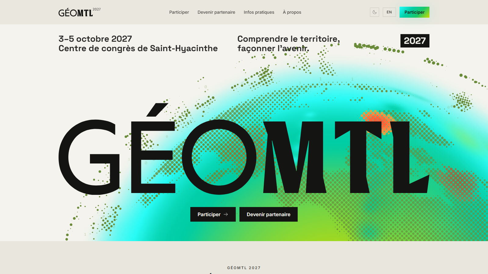

# GÉOMTL 2027

Site web officiel de la conférence GÉOMTL 2027, le rendez-vous de la communauté géospatiale francophone : [www.geomtl.com](https://www.geomtl.com).



**3–5 octobre 2027 · Centre de congrès de Saint-Hyacinthe**

---

## Stack technique

- **Framework** : Next.js 15 (App Router, Server Components), React 19
- **Langage** : TypeScript
- **Style** : Tailwind CSS, identité visuelle 2027 (crème, encre, dégradé cyan → citron) ; l'admin garde l'ancienne palette
- **Icônes** : Phosphor Icons, graisse Light
- **Animations** : Framer Motion (entrées) + globe animé en canvas dans le hero
- **i18n** : next-intl (FR / EN)
- **Base de données** : Supabase (PostgreSQL + Auth), schéma `geomtl2027`
- **Courriels** : Gmail (Google Workspace), via nodemailer
- **Déploiement** : Vercel (projet `geomtl-2027`), depuis la branche `main` du dépôt `GEOMTL-2027`
- **Billetterie** : Le Point de Vente (`EVENT_CONFIG.ticketUrl` dans `data/config.ts`)
- **Infolettre** : Mailchimp ([docs/infolettre.md](docs/infolettre.md))

---

## Démarrage local

```bash
npm install
cp .env.local.example .env.local   # remplir les clés Supabase
npm run dev
```

Ouvrir [http://localhost:3000](http://localhost:3000). Sans `NEXT_PUBLIC_SUPABASE_URL`, le site tourne en mode démo : l'admin est ouvert, avec des données fictives, et rien n'est enregistré.

Attention : avec les vraies clés dans `.env.local`, le site local écrit dans la base de production et peut envoyer de vrais courriels.

### Variables d'environnement requises

```
NEXT_PUBLIC_SUPABASE_URL=
NEXT_PUBLIC_SUPABASE_ANON_KEY=
SUPABASE_SERVICE_ROLE_KEY=          # serveur uniquement, jamais exposé client

# Ouverture du site
SITE_PUBLIC=                        # true : site public ; sinon, page « Site en construction »
CODE_ACCES_COMITE=                  # code du comité tant que le site est en construction

# Demandes de kiosque (voir docs/demandes-kiosques.md)
GMAIL_UTILISATEUR=                  # compte Google Workspace qui envoie (info@geomtl.com)
GMAIL_MOT_DE_PASSE=                 # mot de passe d'application de ce compte
DEMANDES_SEL=                       # sel secret de l'empreinte IP
COURRIEL_EXPEDITEUR=                # facultatif, alias Gmail (partenariat@geomtl.com par défaut)
COURRIEL_COMITE=                    # facultatif, partenariat@geomtl.com par défaut
```

Le détail de chaque variable est dans `.env.local.example`.

---

## Ouverture au public

Le site est public depuis octobre 2026 (`SITE_PUBLIC=true` dans Vercel). Sans cette valeur, il affiche la page « Site en construction », et le comité y entre avec `CODE_ACCES_COMITE`.

- `robots.txt` et `sitemap.xml` sont produits à la compilation : **redéployer** après un changement de `SITE_PUBLIC`.
- L'adresse publique du site est fixée dans `lib/site.ts`. Le suivi Google se fait dans Search Console (voir [docs/referencement.md](docs/referencement.md)).

Fichiers liés :

- **Icônes** : `app/favicon.ico` (16, 32 et 48 px), `app/icon.svg` et `app/apple-icon.png`. C'est le G du logo (`components/ui/GeoMTLLogo.tsx`) en encre sur le dégradé 2027.
- **Image de partage** (LinkedIn, courriels, messageries) : `app/[locale]/opengraph-image.tsx`, une version par langue, générée par Next.
- **Référencement** : `lib/site.ts`, `lib/seo.ts`, `app/sitemap.ts`, `app/robots.ts` et `components/seo/DonneesEvenement.tsx`. Voir [docs/referencement.md](docs/referencement.md).
- **Pages d'erreur** : `app/[locale]/not-found.tsx` (404 du site, alimentée par la route `app/[locale]/[...rest]`), `app/not-found.tsx` (404 hors des pages du site), `app/[locale]/error.tsx` (erreur 500) et `app/global-error.tsx` (dernier recours).

---

## Structure du projet

```
app/
  [locale]/           Pages publiques FR/EN (Next.js i18n routing)
  admin/              Interface de gestion (connexion et rôle requis)
  api/                Routes serveur (demandes de kiosque, accès comité)
components/
  admin/              Écrans de l'administration
  home/               Sections de la page d'accueil (Hero, GlobeTrame, WhyAttend, …)
  infolettre/         Formulaire d'inscription à l'infolettre
  layout/             Header, Footer, bascule du mode sombre
  partners/           Page Devenir partenaire, plan et formulaire de demande
  seo/                Données structurées de l'événement
  ui/                 Composants réutilisables (GeoMTLLogo, SectionTitle, …)
data/                 Configuration de l'événement (config.ts) et contenus du site
lib/                  Utilitaires, client Supabase, actions serveur
messages/             Traductions FR/EN (next-intl)
public/documents/     Documents publics (guide de l'exposant)
public/images/brand/  Visuels de l'identité 2027 et données du globe animé
scripts/              Régénération du globe (globe/) et des globes des niveaux (cartes/)
supabase/             Migrations SQL et journal des migrations
docs/                 Documentation
images/               Capture de ce README
logo/                 Versions de travail et archives du logo
```

---

## Logo

Le site utilise le composant React `GeoMTLLogo` (`components/ui/GeoMTLLogo.tsx`), qui dessine le mot-symbole GÉOMTL dans la couleur du texte : encre en mode clair, crème en mode sombre. Le hero l'affiche en grand par-dessus le globe animé.

Le dossier `logo/` garde les versions de travail et les archives. Le site n'en charge aucune.

---

## Documentation

- [Globe animé du hero](docs/globe-anime.md) : fonctionnement, réglages, régénération des données
- [Identité visuelle 2027 dans le code](docs/identite-visuelle-2027.md) : couleurs, mode sombre, icônes, visuels
- [Demandes de kiosque](docs/demandes-kiosques.md) : plan interactif, formulaire, traitement dans l'admin, sécurité, envoi des courriels par Gmail
- [Administration](docs/admin.md) : menu, page Partenaires et exposants, types de partenaire, contacts des fiches
- [Référencement](docs/referencement.md) : balises, pages indexées ou masquées, données de l'événement, image de partage
- [Infolettre](docs/infolettre.md) : formulaire, réglages Mailchimp, premier envoi
- [Journal des migrations](supabase/CHANGELOG.md) : migrations SQL, configuration de Supabase
- [TODO](TODO.md) et [IDEAS](IDEAS.md) : tâches restantes et idées

Le guide d'utilisation de l'admin pour le comité est un PDF interne, gardé hors de ce dépôt public.

---

## Admin

Accessible à `/admin` après connexion par courriel et mot de passe sur `/login`, avec « Mot de passe oublié ». Détails dans [docs/admin.md](docs/admin.md).

Chaque action serveur vérifie elle-même le rôle (`lib/auth/droits.ts`) : à reprendre dans toute nouvelle action.

Rôles : `admin` (accès complet) · `editor` (sans suppression ni gestion des utilisateurs) · `viewer` (lecture seule). Les comptes se gèrent dans la section Utilisateurs.

Sections : Tableau de bord · Partenaires et exposants (onglets Demandes, Organisations et Plan des kiosques) · Programmation · Utilisateurs.

Types de partenaire : Or, Argent, Bronze et Soirée réseautage (migration V008). Les exposants ont leur propre table, mais apparaissent dans la même liste que les partenaires.

Pour attribuer le rôle du tout premier administrateur :
```sql
UPDATE geomtl2027.profiles SET role = 'admin' WHERE email = 'ton@email.com';
```

---

## Migrations SQL

Les migrations sont dans `supabase/migrations/` et numérotées `V000` → `V012`. Les exécuter dans l'ordre via le SQL Editor de Supabase. L'état de chacune est dans [supabase/CHANGELOG.md](supabase/CHANGELOG.md).

Vercel déploie dès qu'un commit arrive sur `main`. Appliquer une migration **avant** de pousser le code qui en dépend.
